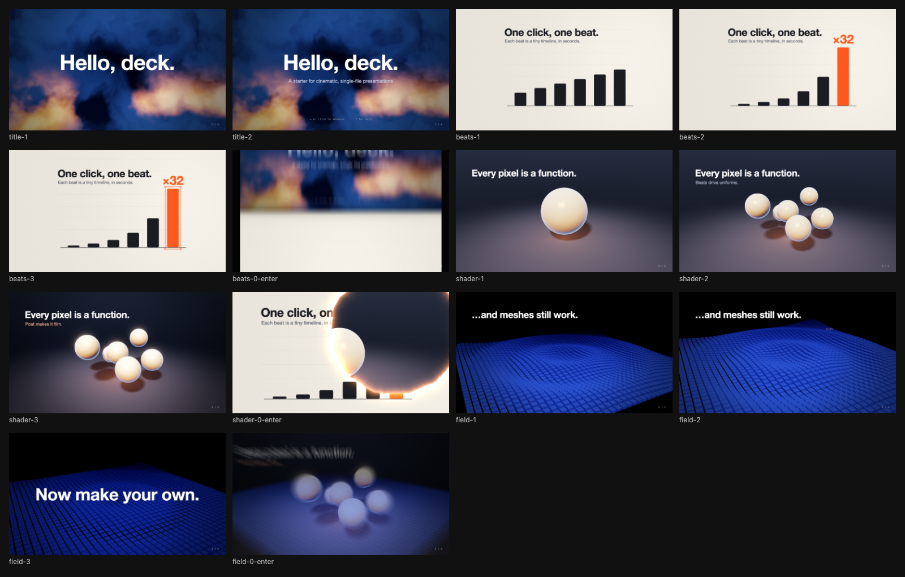
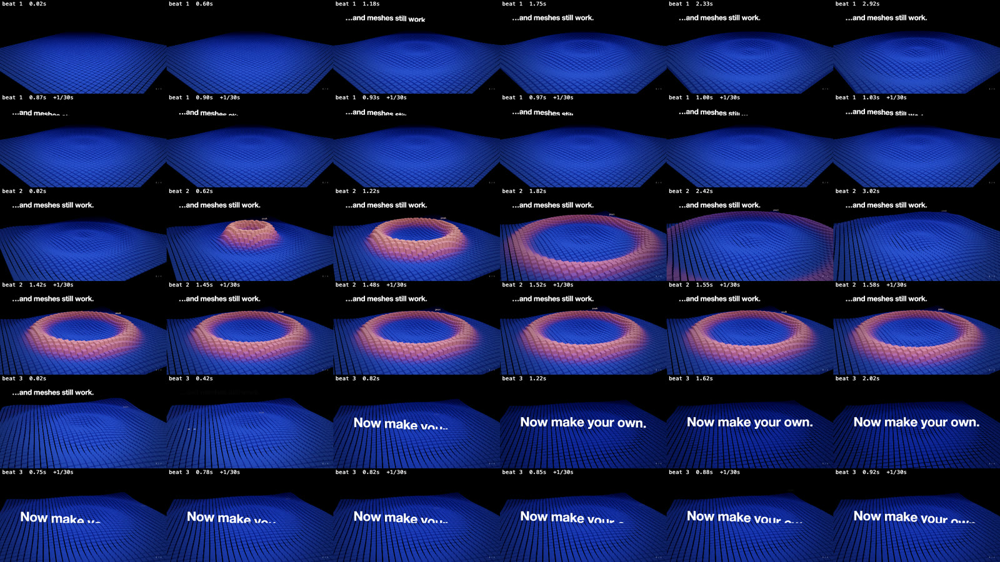

# Cinematic Deck Playbook

How to build presentations that feel like short films: one full-window WebGL canvas, scenes instead of slides, shader transitions, synthesised sound, all shipped as a single HTML file.

This repo has two halves:

1. **The lessons** (`docs/`) — teardowns of two pieces of generated work, written up as reusable techniques and rules.
2. **A starter kit** (`src/`, `tools/`) — an original, working deck engine with a four-scene demo deck, a one-command single-file build, and tools that screenshot it, audit its motion, drive it live and export it as video.

Sources studied:

- *The Last Boring Slide*, a 13-slide WebGL talk published as a Claude artifact: https://claude.ai/artifact/Cy2d8Vn63CnzCtonA1LSah (docs 00–10)
- *Creates Everything*, a prompt for a 55-second code-only film with one finished generation and its build notes: https://github.com/RezAIT00/agent-demos/tree/main/prompts/creates-everything (doc 12)
- *We Taught Sand to Talk*, a twelve-scene WebGL short film published as a Claude artifact: https://claude.ai/artifact/U41NU2bGjKBgmzNKGwGdsm (doc 13)

Nothing here is copied from either. The docs describe their techniques in my own words with the numbers that matter; the starter kit and tools are new code written from those ideas.

## Quick start

```bash
npm install
npm run build        # → dist/deck.html (one self-contained file, ~720 KB)
open dist/deck.html  # → / space / click to advance, ? for keys

npm run watch        # rebuild on save (open dist/deck.html?quick to skip warm-up)
npm run shoot        # screenshot every beat of every scene → shots/contact.png
npm run motion       # play every scene frame by frame: film strips, brightness pops, flashes, frozen holds, state leaks
npm run smoke        # drive the live deck forwards and back, fail on any console error
npm run check        # build + shoot + motion + smoke
npm run film         # frame-exact video → dist/deck.mp4 (needs ffmpeg; add -- --sub 8 for motion blur)
```

The demo deck, every beat plus two transitions frozen mid-way (output of `npm run shoot -- --trans`):



And one scene as the motion audit sees it (`npm run motion`): for each beat, six frames across the beat, then six consecutive frames 1/30 s apart at the moment of fastest change:



## The ideas that do most of the work

**Structure**

1. **Scenes and beats, not slides and builds.** A scene owns a list of beats; each click advances one beat; each beat is a small timeline in *seconds*. ([02](docs/02-beats-and-timing.md))
2. **Scenes are pure functions of beat progress.** That one discipline gives you Back, jump-to-slide, warm-up, autoplay and deterministic screenshots for free.
3. **Transitions are shaders over two rendered scenes**, and the scenes take part: they receive the transition's progress and can hand it geometry ("the next slide opens out of *this* rectangle"). ([05](docs/05-transitions.md))
4. **Going back replays the same transition in reverse**, shorter. Nothing is authored twice.

**Picture**

5. **One convention for colour:** shade in linear HDR, then a single finishing pass does bloom → tone map → sRGB → grade → vignette → grain. Text and transitions happen after it. ([03](docs/03-rendering.md))
6. **Dither the final output** by ±1/255. It removes banding from every gradient for almost nothing.
7. **Make crowds a function of a cell id**, not a simulation. Tens of thousands of things, no state, scrubbable.
8. **Cross orders of magnitude in log space** — camera distance, fog, radius. And when something grows exponentially, hold the camera still and rescale the world.
9. **Text is part of the picture**: per-glyph quads from a canvas atlas, animated by a callback, kept legible by scrims *inside* the image. ([04](docs/04-text.md))
10. **Encode the number in the geometry** (26 blades for 26%, a 2:1 gear for "twice as fast") so the picture is the evidence.

**Feel**

11. **A recurring UI motif performs the changes.** In the reference deck a selection box selects, drags and deletes things on screen; it is the deck's "hand". ([08](docs/08-narrative-craft.md))
12. **Never let a hold freeze.** Idle drift, mouse parallax and slow asymptotic creep keep a paused frame alive.
13. **Sound is synthesised, tuned to one root, and fired on threshold crossings** of the thing being animated — never on timers. ([06](docs/06-audio.md))
14. **End each scene on the first frame of the next.** The cut is hidden because there isn't one.

**Robustness**

15. **Warm everything behind a progress bar**: render every beat of every scene and every transition once before the talk, so no shader compiles live. ([01](docs/01-engine.md))
16. **Park what is far away**: scenes more than one slide off shrink their render targets to 2×2.
17. **Cap the pixels** (≈2560×1600) and lower internal resolution when frames get slow.
18. **One impatient click must never break it**: clicking during a transition speeds it up 3.5× and queues the advance.
19. **A headless mode with `seek(scene, beat)`** makes the whole deck screenshot-testable. This is what makes iterating on shader work with an AI practical. ([09](docs/09-build-test-ship.md))
20. **Ship one file**: bundle the code, inline fonts and images as data URIs. It opens from disk, email, or an artifact link.

**Working with an agent that cannot watch** (from the film, [12](docs/12-lessons-from-a-code-film.md))

21. **Judge motion from evidence, not from video**: consecutive-frame strips, a 2 fps sheet of the whole cut, per-frame brightness, random frames instead of flattering ones.
22. **A frame rendered alone must match the same frame in sequence.** Gate every optional pass and every read of its output with one function.
23. **Audit every brightness jump** and give each a verdict: intended, or a bug with a root cause. Nothing switches on in one frame.
24. **Treatment first, hardest part first, three critique passes, then honest notes**: rebuild what fails rather than polishing it, and write down what could not be judged.
25. **One source of truth for facts**: the headline and the geometry read the same data, and a boot check refuses to run if they cannot agree.

**Phones and everyone else** (from the twelve-scene film, [13](docs/13-lessons-from-a-12-scene-film.md))

26. **Frame for every screen shape**: widen the lens as the screen narrows and shift it (not the camera) to leave room for the headline.
27. **Visible controls, never hover-only**, a hint that leaves on its own, and a smaller pixel budget on phones.
28. **Captions reach screen readers**: the picture is a canvas, so each beat's caption goes to a live region.
29. **Respect reduced motion**: less camera travel, no zoom blur.
30. **A cut that feels like travel**: both cameras keep moving, a zoom blur peaks mid-cut, the mix happens in a window, and the sound glides to the next chord.

## Docs

| | |
|---|---|
| [00 — Anatomy of the reference deck](docs/00-anatomy.md) | What is in the file, slide by slide |
| [01 — The engine](docs/01-engine.md) | Scenes, the controller, render targets, warm-up, parking, quality governor |
| [02 — Beats and timing](docs/02-beats-and-timing.md) | The beat model, sub-timelines, reversibility, pacing numbers |
| [03 — Rendering](docs/03-rendering.md) | Colour pipeline, post stack, shader library, a catalogue of scene techniques, cost control |
| [04 — Text](docs/04-text.md) | Per-glyph text, reveals, counters, legibility |
| [05 — Transitions](docs/05-transitions.md) | The contract and nine recipes |
| [06 — Audio](docs/06-audio.md) | Synthesised sound design |
| [07 — Presenter UI](docs/07-presenter-ui.md) | Keys, notes, overview, deep links |
| [08 — Narrative craft](docs/08-narrative-craft.md) | Structure, motifs, pacing, notes, honesty |
| [09 — Build, test, ship](docs/09-build-test-ship.md) | Single-file build, the screenshot loop, publishing |
| [10 — Scene recipes](docs/10-scene-recipes.md) | Thirteen case studies: idea → technique → rule |
| [11 — Making a new deck with Claude](docs/11-workflow-with-claude.md) | A step-by-step process and prompts |
| [12 — Lessons from a code-only film](docs/12-lessons-from-a-code-film.md) | How to brief and check an agent that cannot watch its own work |
| [13 — Lessons from a twelve-scene film](docs/13-lessons-from-a-12-scene-film.md) | Phones, accessibility, a travel-like cut, a measuring motif, sound per scene |
| [Checklist](docs/checklist.md) | Before you present |
| [Templates](templates/) | A fill-in brief, a treatment table, and a notes skeleton |

## What the starter kit includes, and what it leaves to you

| Area | In the starter | In the reference deck, described in the docs |
|---|---|---|
| Beat model, navigation, reverse, queued advance, autoplay | Yes | Same model |
| Warm-up, parking, pixel cap | Yes | Same |
| Quality governor | Two-way with hysteresis and lockout | Same |
| Design space that extends on non-16:9 windows | Yes | Same |
| Per-glyph text with masked reveals | Offset, alpha, scale, rotate, clip | Adds per-glyph blur, skew, colour, mixed-style runs, 3D placement |
| Post stack | Bloom, ACES, grade, vignette, grain, chromatic aberration | Adds AgX, halation, lift/gain |
| Transitions | fade, iris (with a `portal` hook), shove, push (zoom-blur travel) | Nine, including homography portals, origami fold, water, split-flap, tear |
| Phone and accessibility | Lens fitting, visible controls, hint, phone pixel budget, reduced motion, live captions | The twelve-scene film does all of these; the deck has none |
| Audio | Small bank, one reverb, a live bed with a chord per scene that swells on cuts | 28 sounds, 20 pads, 13 scene beds, per-transition cues |
| Presenter UI | Notes, second window, overview with live thumbnails, help, black screen, deep links | Same, with pre-baked thumbnails |
| Headless `seek` / `seekTransition`, screenshot + smoke tools | Yes | `seek` / `trans` / `perf` hooks |
| Motion audit: strips, jumps, pops, flashes, frozen holds, determinism | Yes (`npm run motion`) | The film's notes describe the same checks run on its video |
| Frame-exact video export with sub-frame motion blur | Yes, silent (`npm run film`) | The film: 32 jittered sub-frames, an offline score mastered to −14 LUFS |

## Layout

```
src/
  engine/       math, glsl library, gfx (targets + passes), view, camera, type, post, audio, ui, deck
  transitions/  iris, shove, push      (fade is built in)
  scenes/       the four demo scenes — copy one to start a new scene
  main.js       scene order, boot, URL switches
  index.html    page shell and presenter-chrome CSS
  facts.js      every number the deck states, with a boot-time check
assets/         anything here is inlined into the build (fonts/, images)
tools/          shoot (screenshots), motion (frame-by-frame audit), smoke (live walk-through), film (video), browser (shared launcher)
templates/      BRIEF.md, TREATMENT.md, NOTES.md
build.mjs       esbuild → one HTML file
docs/           the lessons
```

## Licence note

three.js (MIT) is bundled into the build with its licence header. If you add fonts to `assets/fonts/`, check their licences allow embedding.
